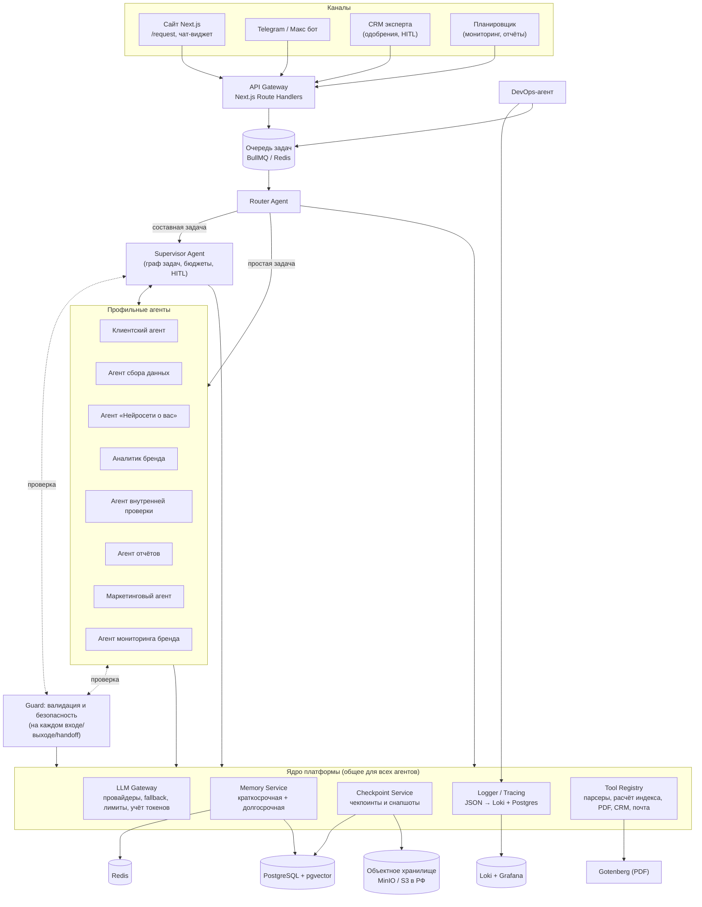
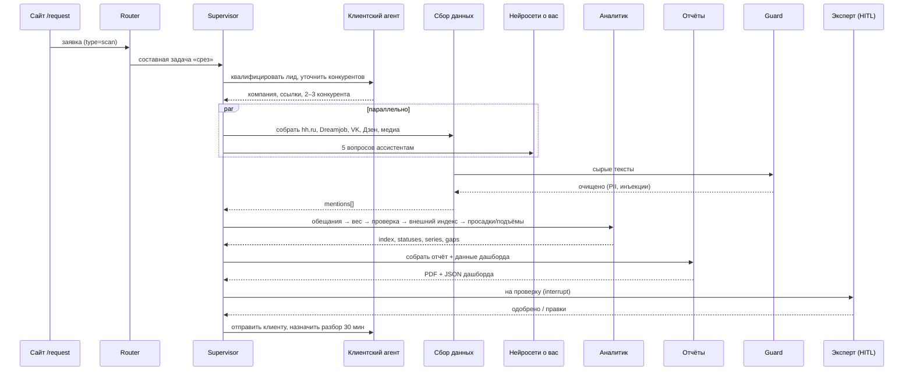
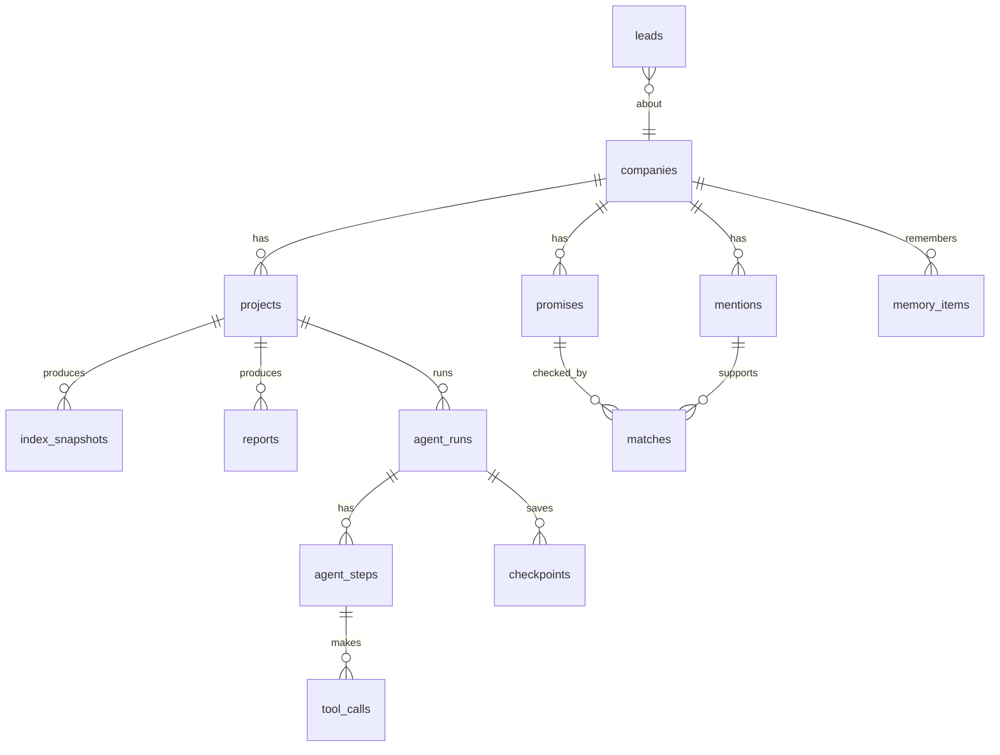
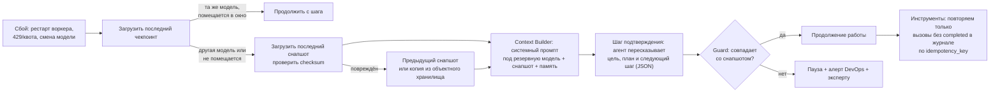

# Mirror: мультиагентная архитектура продукта (v0.1, на будущее)

Документ верхнего уровня об агентах **внутри сервиса Mirror**. Реализация отложена (решение пользователя от 2026-10-24).
Агенты **для разработки сайта** уже созданы отдельно: `.claude/agents/`, память — `.claude/memory/`, логи и хуки — `.claude/hooks/` (см. `CLAUDE.md`).

> **Парсер VK / Дзен / hh.ru / Dreamjob уже существует.** «Агент сбора данных» ниже — это обёртка над существующим парсером (запуск, нормализация, проверка Guard'ом), а не новый парсер.

## 0. Что автоматизируем

Бизнес-процессы Mirror, под которые проектируются агенты:

| Процесс | Сейчас | Что делают агенты |
|---|---|---|
| Заявка с сайта и первый контакт | форма `/request`, менеджер вручную | квалификация лида, ответы на вопросы, запись на разбор с экспертом |
| **Бесплатный внешний срез** (3 дня) | парсер + ручная сборка отчёта | сбор данных, извлечение обещаний, расчёт внешнего индекса, графики, отчёт на 2–3 страницы |
| **Диагностика** (платно, с экспертом) | эксперт вручную | разбор документов компании, ИИ-интервью, внутренний индекс, карта разрывов, черновик плана на 90 дней для эксперта |
| Мониторинг (подписка) | — | регулярный пересчёт, сигналы о просадках и новых темах |
| Нейросети о компании | вручную | опрос Алисы / GigaChat / ChatGPT, источники ответов |
| Маркетинг | вручную | исследования, статьи, контент-план для агентств |
| Эксплуатация | вручную | мониторинг парсеров, очередей, лимитов LLM, инциденты |

**Что сознательно не включаем** (лишнее для продукта сейчас): агента онлайн-оплаты и «истории заказов» в смысле e-commerce (оплата по счёту, онлайн-оплаты нет) — вместо заказов храним **проекты** (срез / диагностика / подписка); агента найма и расчёта текучести (не наша задача); голосового агента.

**Главный принцип:** LLM — для понимания текста (обещания, тональность, соответствие, саммари, формулировки). Всё, что считается формулой (индекс, веса, статусы, просадки на временном ряду), считает **детерминированный код-инструмент**, а не модель. Так результат воспроизводим и проверяем по методике.

---

## 1. Архитектурная схема



### Поток «бесплатный срез» (пример составной задачи)



### Ключевые решения

| Решение | Выбор | Почему |
|---|---|---|
| Язык и рантайм | TypeScript, Node.js 22 | единый стек с сайтом на Next.js 16 |
| Оркестрация | **LangGraph.js** (MIT) | граф состояний, supervisor/handoff, встроенные чекпоинты в Postgres, `interrupt` для одобрения экспертом |
| Где живут агенты | отдельный воркер `agents/` (Node) | долгие задачи (сбор, отчёты) не держим в запросах Next.js; сайт только ставит задачи в очередь |
| Очередь | BullMQ на Redis | повторы, задержки, приоритеты, переживает рестарт воркера |
| БД | PostgreSQL 16 + **pgvector** | уже был Postgres; векторный поиск без отдельной векторной БД; хранение в РФ (152-ФЗ) |
| Логи | pino (JSON) → Loki + Grafana | Loki и Grafana уже были в старом стеке |
| PDF | Gotenberg | уже был в старом стеке |
| Объектное хранилище | MinIO или S3 в РФ (Yandex Object Storage / Selectel) | документы клиентов, PDF, резервные копии снапшотов |

---

## 2. Карта агентов

Общее для всех: каждый агент — узел графа LangGraph с **версионированным** системным промптом (`prompts/<agent>@<version>.md`), строгой схемой выхода (Zod), списком разрешённых инструментов (allow-list) и бюджетом токенов на шаг. Выход любого агента проходит через Guard, прежде чем попасть другому агенту или пользователю.

Обозначения моделей (конкретные — в открытых вопросах): **S** — быстрая дешёвая модель, **M** — основная, **L** — сильная для сложного анализа.

### 2.1 Router Agent — маршрутизатор

| | |
|---|---|
| Роль | классифицирует входящее событие и выбирает исполнителя: одного профильного агента или Supervisor |
| Модель | S (детерминированные правила первыми: `type=scan` из формы маршрутизируется без LLM) |
| Вход | событие `{channel, text?, form?, session_id, user_ref, company_id?}` + краткая память сессии |
| Выход | `{target: AgentId \| "supervisor", intent, confidence, entities: {company?, competitors?, urls?}, needs_human: bool}` |
| Инструменты | `memory.session.get`, `crm.lead.lookup` |
| Правила | `confidence < 0.6` → уточняющий вопрос через Клиентского агента; запросы про чужие данные / внутренние документы без проекта → Guard |

Системный промпт (кратко):
> Ты маршрутизатор сервиса Mirror (диагностика HR-бренда и индекс культуры). Определи намерение и верни JSON по схеме. Намерения: вопрос о продукте/ценах; заявка на срез; диагностика; статус проекта; документы для внутренней проверки; маркетинг; техническая проблема. Если задача требует нескольких агентов — target="supervisor". Не отвечай пользователю сам.

### 2.2 Supervisor Agent — оркестратор

| | |
|---|---|
| Роль | планирует составные задачи (срез, диагностика, мониторинг), раздаёт подзадачи, собирает результаты, следит за бюджетом и сроками, останавливается на одобрениях эксперта |
| Модель | M |
| Вход | цель + контекст проекта из долгосрочной памяти + последний снапшот (при восстановлении) |
| Выход | план `{steps: [{id, agent, input_ref, depends_on, status}]}`, финальный результат проекта, события для CRM |
| Инструменты | `handoff(agent, payload)`, `project.update`, `hitl.request_approval`, `budget.check`, `checkpoint.snapshot` |
| Правила | не выполняет профильную работу сам; любая отправка клиенту и любой вывод о конкретной компании — только после одобрения эксперта; при исчерпании бюджета — снапшот и пауза, а не обрезанный результат |

Системный промпт (кратко):
> Ты координатор проектов Mirror. Разбей цель на шаги по шаблону процесса (срез / диагностика / мониторинг), назначь агентов, отслеживай статусы. Не делай работу профильных агентов. Перед отправкой результата клиенту запроси одобрение эксперта. Веди план как структурированное состояние — его сохраняют снапшоты.

### 2.3 Бизнес-агенты

#### Клиентский агент (поддержка и лиды)
| | |
|---|---|
| Роль | отвечает посетителям и клиентам (о продукте, ценах, методике, статусе проекта), квалифицирует заявки, уточняет конкурентов и ссылки, назначает разбор с экспертом |
| Модель | M |
| Вход | сообщение / форма, история сессии, факты о клиенте из памяти, база знаний (FAQ, методика, цены) |
| Выход | ответ пользователю + `{lead: {company, size, role, channel, competitors[], urls[]}, next_action}` |
| Инструменты | `kb.search` (RAG по FAQ и методике), `crm.lead.upsert`, `project.status`, `calendar.slots`, `notify.email`, `notify.telegram` |
| Правила | не обещает сроков и цен вне базы знаний; не раскрывает данные других компаний; персональные данные — только в CRM, не в векторную память |

#### Агент сбора данных (парсер)
| | |
|---|---|
| Роль | собирает внешние упоминания работодателя: вакансии и EVP (hh.ru), отзывы (Dreamjob), VK, Дзен/медиа, поисковая выдача; нормализует и дедуплицирует |
| Модель | S — только для разметки страниц, где нет структуры; основная работа — код |
| Вход | `{company, urls, competitors[], period}` |
| Выход | `mentions[]: {source, url, date, author_role?, text, kind: vacancy\|review\|post\|media}` в БД + отчёт о покрытии |
| Инструменты | `parser.hh`, `parser.dreamjob`, `parser.vk`, `parser.search`, `parser.media`, `dedupe`, `storage.put` |
| Правила | соблюдать условия использования источников и rate-limit; имена авторов не сохранять; каждый текст проходит Guard (инъекции, PII) до попадания в LLM |

#### Агент «Нейросети о вас»
| | |
|---|---|
| Роль | задаёт ассистентам 5 стандартных вопросов о компании и конкурентах, сохраняет ответы и их источники |
| Модель | внешние ассистенты — объект исследования; для анализа ответов — S |
| Вход | `{company, competitors[]}` |
| Выход | `ai_answers[]: {assistant, question, answer, sources[], stance: советует\|нейтрально\|отговаривает, topics[]}` |
| Инструменты | `assistant.ask` (Алиса, GigaChat, ChatGPT — по доступности), `mentions.link_sources` |

#### Аналитик бренда (аналитик данных)
| | |
|---|---|
| Роль | извлекает обещания, сопоставляет упоминания с обещаниями, считает тональность, внешний и внутренний индекс, разрывы, **просадки и подъёмы** на временном ряду, сравнение с конкурентами |
| Модель | L для извлечения обещаний и сопоставления; расчёты — код |
| Вход | `mentions[]`, `internal_evidence[]` (из диагностики), прошлые снимки индекса |
| Выход | `promises[] {title, weight}`, `matches[] {mention_id, promise_id, verdict: confirms\|contradicts\|neutral}`, `index {external, internal, reliability}`, `series[]`, `events[] {date, side, direction: dip\|rise, magnitude, drivers[]}` |
| Инструменты | `index.calculate` (методика v1.0: веса, статусы 60/40, свежесть 12/24 мес.), `series.detect_changes`, `embeddings.search`, `stats.tonality` |
| Правила | ни одного числа «из головы» — только из инструментов; каждый вывод ссылается на id упоминаний |

#### Агент внутренней проверки (документы и интервью)
| | |
|---|---|
| Роль | разбирает документы компании (EVP, политики, опросы), проводит и расшифровывает ИИ-интервью, обезличивает цитаты, выдаёт подтверждения обещаний изнутри |
| Модель | M/L, **только провайдеры с хранением в РФ** |
| Вход | файлы проекта (только при флаге NDA), расписание интервью, список обещаний от Аналитика |
| Выход | `internal_evidence[] {promise_id, verdict, quote_anonymized, source_type: doc\|survey\|interview}` |
| Инструменты | `files.read` (PDF, DOCX, XLSX), `interview.run`, `transcribe`, `anonymize`, `guard.pii_check` |
| Правила | данные одной компании никогда не попадают в контекст другой (изоляция по `company_id`); цитату не включаем, если по ней можно узнать человека |

#### Агент отчётов (генерация контента для клиента)
| | |
|---|---|
| Роль | собирает отчёт среза (2–3 стр.) и диагностики, данные для дашборда, черновик плана на 90 дней для эксперта |
| Модель | M |
| Вход | результаты Аналитика и Внутренней проверки, шаблон отчёта |
| Выход | `report.json` (данные дашборда), HTML → PDF, черновик рекомендаций со статусом `draft` |
| Инструменты | `report.render` (шаблоны), `pdf.gotenberg`, `charts.export`, `storage.put` |
| Правила | формулировки — по стилю Mirror; каждое утверждение с цифрой — ссылка на расчёт; финальную версию одобряет эксперт |

#### Маркетинговый агент
| | |
|---|---|
| Роль | исследования по отраслям на обезличенных агрегатах, статьи и посты, контент-план для агентств (white-label) |
| Модель | M |
| Вход | агрегаты по отрасли (без названий клиентов), бриф, редакционный план |
| Выход | черновики статей/постов со статусом `draft`, контент-план |
| Инструменты | `analytics.aggregate` (только обезличенное), `kb.search`, `cms.draft` |
| Правила | никогда не использует данные конкретных клиентов без письменного согласия; публикация — только человеком |

#### Агент мониторинга бренда (подписка)
| | |
|---|---|
| Роль | по расписанию запускает пересчёт для подписчиков, сравнивает с прошлым замером, формирует сигналы |
| Модель | S |
| Вход | расписание, последний снимок индекса, новые упоминания |
| Выход | `signals[] {type: dip\|rise\|new_topic, promise?, delta, evidence[]}`, ежемесячная сводка |
| Инструменты | `scheduler`, `handoff(Сбор данных, Аналитик)`, `notify.*` |

### 2.4 Технические агенты

#### Guard — агент валидации данных и безопасности
Работает как **middleware** на каждом входе, выходе и передаче между агентами; часть проверок — код (быстро и дёшево), часть — модель S.

| Проверка | Как |
|---|---|
| Схема выхода агента | Zod; при ошибке — один авто-ремонт, затем ошибка шага |
| Инъекции в собранных текстах («игнорируй инструкции…») | эвристики + классификатор S; подозрительный текст помечается и передаётся только как данные в разметке `<external_text>` |
| PII и 152-ФЗ | поиск ФИО, телефонов, e-mail, паспортов → маскирование до записи в логи и векторную память |
| Изоляция арендаторов | любой запрос к памяти и файлам обязан иметь `company_id`; кросс-доступ блокируется |
| Политика ответа клиенту | нет обещаний вне базы знаний, нет данных чужих компаний, нет «цифр без расчёта» |
| Выход | `{verdict: pass\|repair\|block, issues[], redactions[]}` + событие `guard.*` в лог |

#### DevOps / мониторинг-агент
| | |
|---|---|
| Роль | следит за здоровьем системы: падения парсеров, рост очередей, ошибки и лимиты LLM, расход токенов, задержки; открывает инциденты и выполняет безопасные действия |
| Модель | S + правила алертов |
| Вход | метрики и логи (Loki/LogQL), состояние очередей, бюджеты |
| Выход | инцидент `{severity, component, evidence, action_taken, runbook}`, сообщение в Telegram команды |
| Инструменты | `logs.query`, `queue.stats`, `queue.retry`, `queue.pause`, `llm.circuit.status`, `notify.telegram` |
| Правила | **разрешено**: повтор задачи, пауза очереди, переключение на резервную модель; **запрещено**: изменения в БД, деплой, удаление данных — только предложение человеку |

---

## 3. Память и контекст

### 3.1 Уровни памяти

| Уровень | Где | Что | Срок |
|---|---|---|---|
| Рабочая (step) | состояние графа LangGraph | сообщения текущего шага, результаты инструментов | шаг |
| Краткосрочная (сессия) | **Redis** | диалог сессии, текущее состояние агентов, счётчики токенов, блокировки | TTL 24 ч (диалог), 7 дней (проектная сессия) |
| Чекпоинты | **Postgres** (`checkpoints`) + копия в объектном хранилище | полное состояние графа после каждого шага + сжатые снапшоты | 90 дней |
| Долгосрочная структурированная | **Postgres** | компании, лиды, проекты, обещания, упоминания, индексы, отчёты, решения агентов | постоянно (с учётом 152-ФЗ) |
| Долгосрочная семантическая | **pgvector** | факты, предпочтения, решения, база знаний, эмбеддинги упоминаний | постоянно / по политике |

### 3.2 Ключи Redis

```
sess:{session_id}:msgs        LIST   последние сообщения (JSON), обрезка до 50
sess:{session_id}:state       HASH   active_agent, project_id, company_id, step, token_used
run:{run_id}:scratch          HASH   промежуточные данные шага графа
run:{run_id}:lock             STRING блокировка выполнения (SET NX PX)
rl:{provider}:{model}:tpm     ZSET   скользящее окно токенов/минуту
rl:{provider}:{model}:rpm     ZSET   скользящее окно запросов/минуту
cb:{provider}:{model}         HASH   состояние circuit breaker (closed/open/half_open, failures, opened_at)
bull:*                        —      очереди BullMQ
```

### 3.3 Схема Postgres (основное)



| Таблица | Назначение |
|---|---|
| `companies` | компания-работодатель (клиент или конкурент), `is_client` |
| `leads` | заявки с сайта: контакт, роль, канал (персональные данные — только здесь) |
| `projects` | срез / диагностика / мониторинг: тип, статус, флаг NDA, эксперт, сроки — *замена «истории заказов»* |
| `mentions` | собранные тексты: источник, дата, текст (обезличенный), `embedding vector(1024)` |
| `promises`, `matches` | обещания с весами и вердикты соответствия |
| `index_snapshots` | значения индекса по датам и сторонам (external/internal) — ряд для графиков |
| `reports` | версии отчётов, статус одобрения экспертом |
| `agent_runs`, `agent_steps`, `tool_calls` | история решений и действий агентов (для аудита и аналитики) |
| `checkpoints` | чекпоинты и снапшоты (раздел 4) |
| `memory_items` | долгосрочные факты: `scope (user\|company\|global)`, `kind (fact\|preference\|decision\|lesson)`, `text`, `embedding`, `importance`, `source_run_id`, `expires_at` |
| `kb_chunks` | база знаний (FAQ, методика, цены) с эмбеддингами |
| `llm_payloads` | полные промпты и ответы (шифрованные, 30–90 дней), на них ссылаются логи |

### 3.4 Запись и чтение долгосрочной памяти

**Запись** — не «всё подряд», а через `memory.propose`:
1. Агент предлагает кандидата `{scope, kind, text, importance, source}`.
2. Guard маскирует PII и проверяет изоляцию `company_id`.
3. Дедупликация: если похожий факт (косинус ≥ 0,92) уже есть — обновляем `last_seen`, не дублируем.
4. Решения агентов (`decision`) пишутся всегда — для аудита «почему так решили».

**Чтение** — Context Builder собирает контекст под бюджет модели:

| Часть контекста | Доля бюджета |
|---|---|
| системный промпт и правила | ~10% |
| задача и план (из состояния / снапшота) | ~15% |
| память: SQL-факты проекта + векторный top-k с учётом свежести и важности | ~20% |
| рабочая история (последние сообщения дословно) | ~40% |
| результаты инструментов (обрезанные до ссылок + выжимок) | ~15% |

Поиск гибридный: фильтр SQL (`company_id`, `project_id`, `kind`) → векторный top-k → переранжирование `score = similarity × importance × recency_decay`.

---

## 4. Отказоустойчивость, лимиты и контекстный бэкап

### 4.1 Два уровня сохранения

| | Чекпоинт (hot) | Снапшот (compressed) |
|---|---|---|
| Когда | после **каждого** шага графа | каждые **N = 8** шагов; при заполнении контекста ≥ **60%** окна модели; перед handoff; перед рискованным вызовом инструмента; при ошибке 429/5xx; по SIGTERM |
| Что | полное состояние графа LangGraph (PostgresSaver) | сжатое структурированное состояние + саммари истории |
| Зачем | точное продолжение на той же модели | продолжение на **любой** модели, включая резервную с меньшим окном |
| Где | Postgres | Postgres (транзакционно) → асинхронная копия в объектное хранилище, контрольная сумма SHA-256 |

### 4.2 Формат снапшота

```json
{
  "snapshot_id": "snp_01JD…",
  "run_id": "run_01JD…",
  "session_id": "ses_…",
  "project_id": "prj_…",
  "company_id": "cmp_…",
  "agent_id": "supervisor",
  "graph_version": "scan-flow@1.2.0",
  "created_at": "2026-10-24T12:30:05.120Z",
  "reason": "token_threshold",
  "step_index": 24,
  "goal": "Бесплатный внешний срез для компании «Банк N»",
  "plan": [
    { "id": "collect", "agent": "collector", "status": "done", "output_ref": "s3://…/mentions.json" },
    { "id": "ai_answers", "agent": "ai_answers", "status": "done", "output_ref": "db:ai_answers?project=prj_…" },
    { "id": "analyze", "agent": "analyst", "status": "in_progress", "progress": "сопоставлено 310 из 415 упоминаний" },
    { "id": "report", "agent": "reporter", "status": "pending" }
  ],
  "key_facts": [
    "Конкуренты: Федеральный банк А, Федеральный банк Б",
    "8 обещаний, самый тяжёлый вес — «Справедливая зарплата» (22%)"
  ],
  "decisions": [
    { "text": "Dreamjob за 2023 г. учитывается с весом 0.5 (свежесть 12–24 мес.)", "by": "analyst", "step": 19 }
  ],
  "open_questions": ["Клиент не подтвердил ссылку на VK-сообщество"],
  "pending_tool_calls": [
    { "tool": "index.calculate", "idempotency_key": "prj_…:analyze:batch-4", "status": "not_started" }
  ],
  "history_summary": "Сжатая сводка диалога и действий до шага 16…",
  "recent_messages": [ "последние 6 сообщений дословно (PII замаскированы)" ],
  "memory_refs": ["mem_…", "mem_…"],
  "model": { "provider": "…", "name": "…", "fallback_level": 0 },
  "tokens": { "run_total_in": 182340, "run_total_out": 21410, "budget_left": 120000 },
  "checksum": "sha256:…"
}
```

Саммаризацию делает отдельный узел `compactor` (модель S/M) со **строгой схемой**: факты, решения и план переносятся структурированно, в свободный текст уходит только «как мы к этому пришли». Числа и ссылки компактор не пересказывает, а копирует.

### 4.3 Восстановление



Ключевые гарантии:
- **Нет двойных действий.** Каждый вызов инструмента с побочным эффектом (письмо клиенту, запись в CRM, генерация PDF) имеет `idempotency_key`; журнал `tool_calls` хранит `started/completed`. При восстановлении завершённые вызовы не повторяются.
- **Задача не теряется.** Задачи лежат в BullMQ (Redis с AOF) и дублируются статусом в `agent_runs`; воркер при старте подбирает незавершённые `run` и восстанавливает их.
- **Нет «молчаливой» потери логики.** После восстановления — шаг подтверждения, сверка Guard'ом, при расхождении — пауза и человек.

### 4.4 Лимиты и отказы провайдеров

| Механизм | Как работает |
|---|---|
| Учёт до вызова | подсчёт токенов промпта до отправки; если не помещается в бюджет — сначала компакция (снапшот), потом вызов |
| Токен-бакет | лимиты TPM/RPM на провайдера и модель в Redis; при нехватке — задача ждёт в очереди, а не падает |
| Повторы | экспоненциальная задержка с джиттером, уважение `Retry-After`, максимум 3 попытки |
| Circuit breaker | 5 ошибок за 60 с → провайдер «открыт» на 2 мин → пробный запрос (half-open) |
| Цепочка fallback | на каждого агента: основная → резервная → малая модель → «отложить задачу» (для неотложного ответа клиенту — шаблонный ответ и эскалация человеку) |
| Бюджет | лимит токенов и рублей на проект и на сутки; при исчерпании — снапшот, пауза, уведомление |
| Деградация | детерминированные части (парсеры, расчёт индекса, PDF) продолжают работать без LLM |
| Большие документы | map-reduce: разбиение на фрагменты, выжимки с сохранением ссылок на источник |

---

## 5. Сквозное логирование

### 5.1 Принципы
- Один формат JSON для всех агентов, библиотека pino; поток → stdout → Promtail → **Loki**, дашборды в **Grafana**.
- Трассировка в стиле OpenTelemetry: `trace_id` на всю задачу (например, весь срез), `span_id` на шаг агента / вызов модели / вызов инструмента, `parent_span_id` для дерева цепочки.
- **152-ФЗ:** в лог пишем текст промпта и ответа **после маскирования PII**; полный текст — в `llm_payloads` (шифрование, ограниченный доступ, хранение 30–90 дней), лог ссылается на него `payload_ref`.
- Дублирование ключевых событий в Postgres (`agent_steps`, `tool_calls`) для SQL-аналитики: стоимость проекта, качество агентов, частота fallback.

### 5.2 Схема записи

```json
{
  "$schema": "https://json-schema.org/draft/2020-12/schema",
  "title": "MirrorAgentLogEvent",
  "type": "object",
  "required": ["ts", "level", "event", "trace_id", "span_id", "agent", "session_id", "status"],
  "properties": {
    "ts": { "type": "string", "format": "date-time" },
    "level": { "enum": ["debug", "info", "warn", "error"] },
    "event": {
      "enum": [
        "run.start", "run.end",
        "llm.request", "llm.response",
        "tool.call", "tool.result",
        "handoff", "guard.check",
        "snapshot.created", "snapshot.restored",
        "fallback.switch", "ratelimit.wait", "circuit.open",
        "hitl.request", "hitl.response",
        "error"
      ]
    },
    "trace_id": { "type": "string" },
    "span_id": { "type": "string" },
    "parent_span_id": { "type": ["string", "null"] },
    "run_id": { "type": "string" },
    "session_id": { "type": "string" },
    "user_ref": { "type": ["string", "null"], "description": "псевдоним пользователя, не e-mail" },
    "company_id": { "type": ["string", "null"] },
    "project_id": { "type": ["string", "null"] },
    "agent": {
      "type": "object",
      "properties": {
        "id": { "type": "string" },
        "version": { "type": "string" },
        "prompt_version": { "type": "string" }
      }
    },
    "model": {
      "type": ["object", "null"],
      "properties": {
        "provider": { "type": "string" },
        "name": { "type": "string" },
        "fallback_level": { "type": "integer" }
      }
    },
    "prompt": {
      "type": ["object", "null"],
      "properties": {
        "text_redacted": { "type": "string", "description": "промпт после маскирования PII, обрезан до 8 КБ" },
        "hash": { "type": "string" },
        "payload_ref": { "type": "string" }
      }
    },
    "tokens": {
      "type": ["object", "null"],
      "properties": {
        "input": { "type": "integer" },
        "output": { "type": "integer" },
        "cached": { "type": "integer" },
        "cost_rub": { "type": "number" }
      }
    },
    "completion": {
      "type": ["object", "null"],
      "properties": {
        "text_redacted": { "type": "string" },
        "finish_reason": { "type": "string" },
        "payload_ref": { "type": "string" }
      }
    },
    "tool": {
      "type": ["object", "null"],
      "properties": {
        "name": { "type": "string" },
        "args_redacted": { "type": "object" },
        "result_summary": { "type": "string" },
        "result_ref": { "type": "string" },
        "idempotency_key": { "type": "string" },
        "duration_ms": { "type": "integer" }
      }
    },
    "status": { "enum": ["success", "error", "retry", "blocked", "waiting"] },
    "error": {
      "type": ["object", "null"],
      "properties": {
        "type": { "type": "string" },
        "message": { "type": "string" },
        "retryable": { "type": "boolean" },
        "http_status": { "type": "integer" }
      }
    },
    "latency_ms": { "type": "integer" },
    "attempt": { "type": "integer" },
    "tags": { "type": "array", "items": { "type": "string" } }
  }
}
```

### 5.3 Пример цепочки

```json
{"ts":"2026-10-24T12:30:01.004Z","level":"info","event":"llm.request","trace_id":"tr_scan_8f2","span_id":"sp_41","parent_span_id":"sp_40","run_id":"run_01JD","session_id":"ses_77","user_ref":"u_3c1","company_id":"cmp_bankn","project_id":"prj_204","agent":{"id":"analyst","version":"0.3.0","prompt_version":"analyst@1.1"},"model":{"provider":"provider_a","name":"model_l","fallback_level":0},"prompt":{"text_redacted":"Сопоставь упоминания с обещанием «Карьерный рост»…","hash":"sha256:9a1…","payload_ref":"llm_payloads/0f3…"},"status":"waiting","attempt":1}
{"ts":"2026-10-24T12:30:03.411Z","level":"info","event":"llm.response","trace_id":"tr_scan_8f2","span_id":"sp_41","run_id":"run_01JD","session_id":"ses_77","agent":{"id":"analyst","version":"0.3.0","prompt_version":"analyst@1.1"},"model":{"provider":"provider_a","name":"model_l","fallback_level":0},"tokens":{"input":6120,"output":842,"cached":3900,"cost_rub":1.84},"completion":{"text_redacted":"{\"matches\":[…]}","finish_reason":"stop","payload_ref":"llm_payloads/0f4…"},"status":"success","latency_ms":2407}
{"ts":"2026-10-24T12:30:03.520Z","level":"info","event":"tool.call","trace_id":"tr_scan_8f2","span_id":"sp_42","parent_span_id":"sp_41","run_id":"run_01JD","session_id":"ses_77","agent":{"id":"analyst","version":"0.3.0","prompt_version":"analyst@1.1"},"tool":{"name":"index.calculate","args_redacted":{"project_id":"prj_204","side":"external"},"idempotency_key":"prj_204:analyze:index-ext"},"status":"waiting"}
{"ts":"2026-10-24T12:30:03.588Z","level":"info","event":"tool.result","trace_id":"tr_scan_8f2","span_id":"sp_42","run_id":"run_01JD","session_id":"ses_77","agent":{"id":"analyst","version":"0.3.0","prompt_version":"analyst@1.1"},"tool":{"name":"index.calculate","result_summary":"external=65, confirmed 5/8, reliability=high","result_ref":"db:index_snapshots/911","duration_ms":68},"status":"success"}
{"ts":"2026-10-24T12:31:10.002Z","level":"warn","event":"fallback.switch","trace_id":"tr_scan_8f2","span_id":"sp_57","run_id":"run_01JD","session_id":"ses_77","agent":{"id":"reporter","version":"0.2.0","prompt_version":"reporter@1.0"},"model":{"provider":"provider_b","name":"model_m","fallback_level":1},"error":{"type":"rate_limit","message":"429 Too Many Requests","retryable":true,"http_status":429},"status":"retry","attempt":3,"tags":["snapshot:snp_01JD"]}
```

### 5.4 Дашборды Grafana
- цепочка задачи по `trace_id` (дерево агентов и инструментов);
- токены и стоимость по агентам, проектам, моделям;
- доля ошибок, повторов, fallback, срабатываний Guard;
- задержки p50/p95 по агентам и инструментам;
- очереди BullMQ: длина, возраст старейшей задачи.

---

## 6. Структура кода (план)

```
MirrorV2/
  src/                         сайт Next.js (уже есть)
    app/api/agents/…           Route Handlers: принять событие → положить в очередь, статус задачи
  agents/                      воркер агентов (отдельный процесс)
    core/
      llm/                     LLM Gateway: адаптеры провайдеров, fallback, лимиты, учёт токенов
      memory/                  Redis + Postgres + pgvector, Context Builder
      checkpoint/              PostgresSaver, снапшоты, компактор, восстановление
      logging/                 pino-логгер, схема событий, маскирование PII
      guard/                   проверки схем, PII, инъекций, изоляции
      tools/                   реестр инструментов + idempotency
    agents/                    router, supervisor, lead, collector, ai-answers, analyst,
                               internal, reporter, marketing, brand-monitor, devops
    graphs/                    scan-flow, diagnostics-flow, monitoring-flow
    prompts/                   системные промпты с версиями
    worker.ts                  BullMQ-воркер
  db/migrations/               SQL-миграции (Flyway, как в старом проекте)
  docker-compose.yml           postgres+pgvector, redis, loki, grafana, gotenberg, minio
```

## 7. Этапы реализации

| # | Этап | Результат и проверка |
|---|---|---|
| 1 | Инфраструктура: docker-compose, миграции, воркер, очередь | `docker compose up` поднимает всё; тестовая задача проходит очередь |
| 2 | Логирование и LLM Gateway | каждый вызов модели даёт пару `llm.request/response` по схеме; токены и стоимость считаются |
| 3 | Память: Redis-сессии, Postgres, pgvector, Context Builder | тесты записи/дедупликации/поиска; изоляция по `company_id` |
| 4 | Чекпоинты, снапшоты, восстановление, fallback, лимиты | тест «убить воркер на шаге 5 → продолжение с шага 5»; тест «429 → резервная модель с тем же планом» |
| 5 | Guard, Router, Supervisor | маршрутизация на наборе тестовых запросов; блокировка инъекций и PII |
| 6 | Срез: Клиентский агент → Сбор данных → Нейросети → Аналитик → Отчёты | заявка с `/request` даёт отчёт и данные дашборда на тестовой компании |
| 7 | Диагностика: Внутренняя проверка + HITL эксперта | документы → внутренний индекс → одобрение в CRM |
| 8 | Мониторинг бренда, Маркетинг, DevOps-агент, дашборды Grafana | сигналы о просадках; алерты в Telegram |

## 8. Открытые вопросы (нужно решить до кода)

1. **Провайдеры LLM.** Внутренние документы и интервью — только модели с хранением в РФ (GigaChat / YandexGPT)? Можно ли использовать зарубежные модели (например, Claude) для задач только на открытых данных (сбор, маркетинг, разработка)?
2. **Эмбеддинги.** Облачные (GigaChat / Yandex) или своя открытая модель на сервере (например, multilingual-e5) — это влияет на 152-ФЗ и стоимость.
3. **Хостинг.** Где сервер: Yandex Cloud, Selectel, свой VPS? От этого зависят объектное хранилище и управляемые Postgres/Redis.
4. **Источники данных.** У hh.ru и VK есть официальные API; у Dreamjob публичного API нет — нужна юридическая оценка сбора (условия использования).
5. **Каналы.** Нужен ли чат-виджет на сайте и Telegram-бот на первом этапе или только форма `/request`?
6. **Оркестрация.** Подтвердить LangGraph.js (рекомендую) или делать собственный лёгкий оркестратор.
7. **CRM.** Делаем свою админку для эксперта (как `/crm` в старом сайте) или интеграция с внешней CRM (amoCRM / Битрикс24)?
